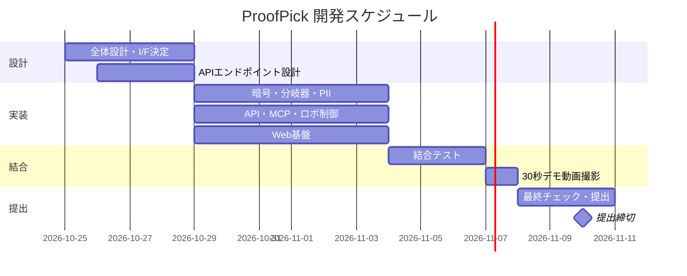

# ProofPick（プルーフピック）

商品選択の「根拠」を証明する AI 買い物代行基盤。
第4回 デジタル学園祭「全国情報教育コンテスト（全情コン2026）」／第1回 愛知県大会 応募作品。

- 理想：誰でも AI ロボを安心して走らせられる社会（インフラ分離）
- 核心：「なぜその商品を選んだか」を証明できること
- 落とし込み：ブラウザで動くデモ（`html/demo.html`）

---

## 役割分担

| 区分 | 内容 |
|---|---|
| 暗号・核心ロジック | 全体企画・暗号（ZK/vFHE/DCSS/TEE）・分岐器核心・PIIマスク・インジェクション防御・エントリーシート・デモ動画 |
| Web 基盤 | Web 注文画面・ダッシュボード / 分岐器の通常動作登録 / タスクログ・商品マスタ DB・テスト |
| API | 自律走行・アーム把持 / API・MCP サーバー構築 / 軽量 Web 実装 |

---

## 計画表

### 暗号・核心ロジック

- [ ] 分岐器トリアージの核心設計（regex＋条件判断、LLM 必要部分のみ抽出）
- [ ] プロンプトインジェクション防御（ユーザプロンプトレベル）
- [ ] PII 自動マスク（正規表現＋機械学習）
- [ ] ZK Lookup / vFHE / DCSS / TEE の暗号回路設計
- [ ] エントリーシート執筆・30秒デモ動画統括

### Web 基盤

- [ ] Web 注文画面・ピッキング管理ダッシュボード（React/Tailwind）
- [ ] 分岐器に登録する「通常動作」の定義・実装
- [ ] タスク実行ログ管理、商品マスタ DB 連携、テストハーネス

### API

- [ ] ロボット制御 API エンドポイント設計（移動・把持・スキャン）
- [ ] MCP（Model Context Protocol）サーバー構築
- [ ] 自律走行・アーム把持ハードウェア制御（UIAPduino / Raspberry Pi）
- [ ] 実行基盤 ⇄ ロボットの連携 API 実装
- [ ] 軽量 Web 実装（注文受付 UI の土台）

---

## スケジュール（提出期限：11/10 17:00）

| フェーズ | 期間 | 内容 |
|---|---|---|
| Phase 1 | 〜10/28 | 設計・インターフェース決定 |
| Phase 2 | 10/29〜11/3 | 各自の実装スプリント |
| Phase 3 | 11/4〜11/7 | 結合テスト & 30秒デモ動画撮影 |
| Phase 4 | 11/8〜11/10 17:00 | 最終チェック・提出 |

---

## 成果物

| ファイル | 内容 |
|---|---|
| `html/demo.html` | 商品選択の根拠を証明する実行基盤デモ（実装版） |
| `html/whiteboard.html` | 6レイヤ・14ノードのアーキテクチャ白板（研究段階の数理詳細つき） |
| `slides/slides.md` | Slidev 製の発表スライド |
| `submission/zenjyocon_entry_sheet_2026.pptx` | 応募用紙 |
| `md/STRATEGY.md` | 開発戦略・実装仕様書 |
| `md/API要件定義書.md` | API の要件定義 |
| `md/Web要件定義書.md` | Web 基盤の要件定義 |