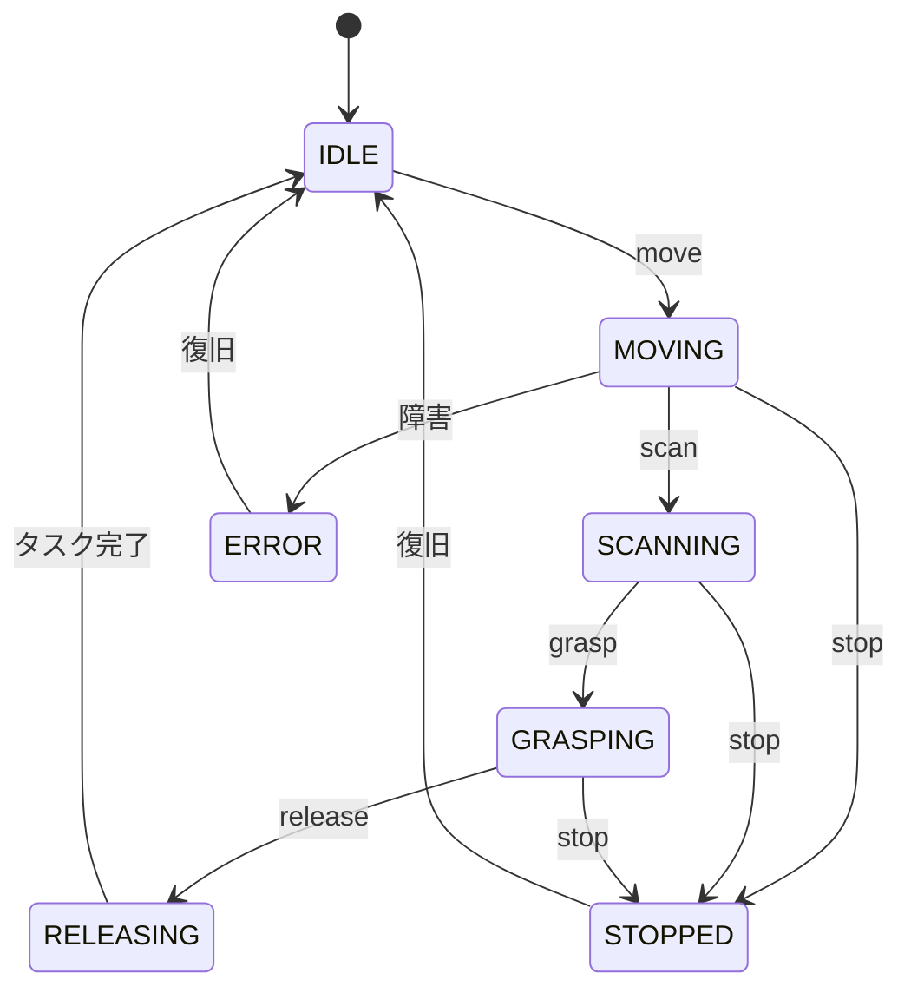
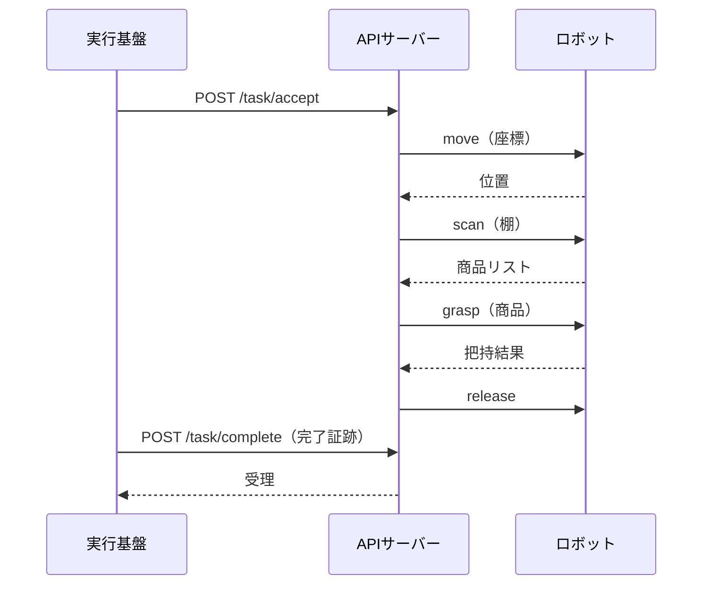

# ProofPick API 要件定義書

> **担当**: 今井
> **対象**: 実行基盤 ⇄ ロボット間のインターフェース
> **更新日**: 2026-10-25

---

## 1. 目的

ProofPick の実行基盤（Execution Harness）と、実際に棚を移動・把持するロボットとの間を結ぶ
**API（アプリケーションプログラミングインターフェース）**の要件を定義する。

本 API は、以下を満たすことを目的とする。

- 実行基盤からの指示（移動・把持・スキャン）をロボットへ安全に伝達する
- ロボットの状態・完了証跡を実行基盤へ返却する
- 個人情報・企業秘密を含まない「必要最小限の命令」だけを流す

---

## 2. 対象範囲

| 項目 | 内容 |
|---|---|
| ロボット制御 API | 移動・把持・リリース・スキャンの命令受け付け |
| 状態取得 API | ロボットの位置・バッテリー・エラー状態の取得 |
| MCP サーバー | AI エージェントが呼び出すツール（Model Context Protocol） |
| ハードウェア制御 | UIAPduino（Arduino 系）／ Raspberry Pi（OP-TEE） |
| 軽量 Web 実装 | 注文受付 UI の土台 |

---

## 3. システム概要

```
実行基盤（Execution Harness）
        │  HTTP / JSON（REST）
        ▼
API サーバー（Raspberry Pi）
        │  GPIO / シリアル
        ▼
ロボット制御（UIAPduino：モーター・アーム）
```

- 実行基盤側は「何を選んだか」を決定済み。API は「物理的な移動・把持」だけを担う
- 判断（何を選ぶか）と実行（どう動かすか）を分離する

---

## 4. 用語定義

| 用語 | 定義 |
|---|---|
| 実行基盤 | 店舗・倉庫に常設するソフトウェア（分岐器・Lookup証明・CNEI を含む） |
| ロボット | 自律走行・アーム把持を行う物理機体 |
| タスク | 商品のピッキング・仕分けなどの作業単位 |
| 完了証跡 | タスクを遂行した証拠（座標・JAN・トルク等のログ） |
| MCP | Model Context Protocol。AI エージェントが外部ツールを呼ぶ標準規格 |

---

## 5. 機能要件

### 5.1 ロボット制御 API（REST / JSON）

| エンドポイント | メソッド | 概要 | 主要パラメータ | レスポンス |
|---|---|---|---|---|
| `/robot/move` | POST | 指定座標へ移動 | `{x, y, theta, speed}` | `{status, position}` |
| `/robot/grasp` | POST | 商品を把持 | `{item_id, torque, approach}` | `{status, grasped}` |
| `/robot/release` | POST | 商品をリリース | `{item_id}` | `{status}` |
| `/robot/scan` | POST | 棚をスキャン | `{shelf_id, bbox}` | `{status, items[]}` |
| `/robot/stop` | POST | 緊急停止 | `{reason}` | `{status}` |
| `/robot/status` | GET | 状態取得 | — | `{position, battery, error}` |

### 5.2 タスク API

| エンドポイント | メソッド | 概要 |
|---|---|---|
| `/task/accept` | POST | タスク受注（実行基盤からの指示を受け取る） |
| `/task/complete` | POST | 完了報告（完了証跡を返却） |
| `/task/fail` | POST | 失敗報告（原因を返却） |

### 5.3 MCP サーバー（AI エージェント用ツール）

| ツール名 | 内容 | 入力 | 出力 |
|---|---|---|---|
| `move_robot` | 移動指示 | 座標・速度 | 実行結果 |
| `grasp_item` | 把持指示 | 商品ID・トルク | 把持結果 |
| `scan_shelf` | 棚スキャン | 棚ID・範囲 | 商品リスト |
| `report_status` | 状態取得 | — | 位置・電池・エラー |

### 5.4 軽量 Web 実装

- 注文受付ページ（最小構成）
- タスク一覧・ロボット状態の表示
- 上記 API を呼び出すフロントエンド（HTML/JS）

---

## 6. 非機能要件

| 分類 | 要件 |
|---|---|
| 性能 | 単一命令の応答は 100ms 以内（ローカル） |
| 可用性 | 通信断時はフェイルセーフ（停止→再試行） |
| セキュリティ | 命令は認証済み実行基盤からのみ受け付け（トークン検証） |
| 安全性 | 予期しない命令は `stop` を優先。トルク・速度に上限 |
| 拡張性 | ロボット機種が変わっても API を変更しない（抽象化） |

---

## 7. インターフェース仕様（JSON 例）

### 7.1 移動命令

```json
// POST /robot/move
{
  "x": 12.5,
  "y": 3.0,
  "theta": 90,
  "speed": 0.5
}
```

```json
// レスポンス
{
  "status": "moving",
  "position": { "x": 12.5, "y": 3.0, "theta": 90 }
}
```

### 7.2 把持命令

```json
// POST /robot/grasp
{
  "item_id": "curry-rice-flour-001",
  "torque": 2.0,
  "approach": "top"
}
```

```json
// レスポンス
{
  "status": "grasped",
  "grasped": true,
  "item_id": "curry-rice-flour-001"
}
```

### 7.3 完了証跡（タスク完了時に返却）

```json
// POST /task/complete
{
  "task_id": "task-0001",
  "decision": "候補B（米粉カレールー）",
  "evidence": {
    "bbox": "[220,40,80,60]",
    "log_line": "2057"
  },
  "timestamp": "2026-10-25T12:00:00Z"
}
```

---

## 8. セキュリティ・安全要件

- **命令の出所検証**: API は実行基盤の署名付きトークンを検証し、未認証の命令を拒否
- **操作上限**: 移動速度・把持トルクに上限を設け、超過は拒否（CNEI と連携）
- **個人情報を流さない**: API には顧客名・住所を含めない（実行基盤側で PII マスク済み）

---

## 9. 状態遷移（ステートマシン）

ロボットは以下の状態を遷移する。



---

## 10. エラーコード

| コード | 意味 | 対処 |
|---|---|---|
| 1000 | 認証トークン不正 | 命令を拒否 |
| 2001 | 指定座標が範囲外 | 移動を中止 |
| 2002 | 把持対象が見つからない | 再スキャン |
| 3001 | トルク・速度の上限超過 | 実行を中止（CNEI 連携） |
| 9001 | 緊急停止 | 全動作を停止 |

---

## 11. MCP ツール詳細スキーマ

```json
{
  "name": "move_robot",
  "description": "指定座標へ移動する",
  "inputSchema": {
    "type": "object",
    "properties": {
      "x": { "type": "number", "description": "X座標(m)" },
      "y": { "type": "number", "description": "Y座標(m)" },
      "theta": { "type": "number", "description": "向き(度)" },
      "speed": { "type": "number", "maximum": 0.5, "description": "移動速度(m/s, 上限0.5)" }
    },
    "required": ["x", "y"]
  }
}
```

他のツールも同形式（`grasp_item` / `scan_shelf` / `report_status`）。

---

## 12. 処理シーケンス（1タスクの流れ）



---

## 13. データモデル

| モデル | フィールド |
|---|---|
| Task | `task_id`, `decision`, `evidence`, `timestamp`, `status` |
| Item | `item_id`, `bbox`, `log_line`, `allergen`, `price` |
| RobotState | `position`, `battery`, `error`, `current_task` |
| Evidence | `bbox`, `log_line`, `grasp_torque`, `move_path` |

---

## 14. 受け入れ基準

- [ ] `move / grasp / release / scan / status / stop` が実機で動作する
- [ ] MCP サーバー経由で AI エージェントがロボットを呼べる
- [ ] 未認証の命令が拒否される
- [ ] 完了証跡（座標・JAN）が実行基盤へ返却される