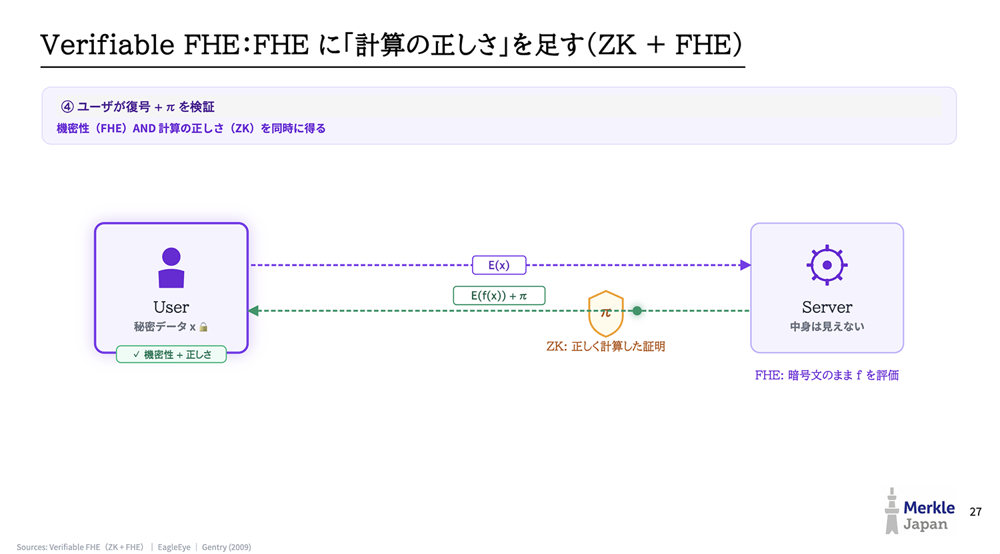

<!DOCTYPE html>
<html lang="ja" class="dark">
<head>
  <meta charset="UTF-8" />
  <meta name="viewport" content="width=device-width, initial-scale=1.0" />
  <title>オープンロボット実行基盤 & ZK/vFHE/監査インフラ統合ホワイトボード (PNG図解・CSS2026・ビジネスモデル完全統合版)</title>
  
  
</head>
<body class="h-screen w-screen flex flex-col select-none">

  <!-- Top Header -->
  <header class="h-14 border-b border-slate-800 bg-slate-900/95 backdrop-blur px-4 flex items-center justify-between shrink-0 z-30">
    

      

      <h1 class="text-sm font-bold tracking-wide text-slate-100">
        ホワイトボード統合設計: 物流・店舗ロボット実行基盤 × Verifiable FHE (ZK+FHE) × AIエージェント保険 (ZK, or not ZK)
      </h1>
      PNG 3枚 + CSS2026 + 実行基盤モック
    

    <!-- View Switcher & Action Tools -->
    

      <!-- Domain Filter Dropdown -->
      

        レイヤ絞り込み:
        <select id="domainFilterSelect" onchange="filterByDomain(this.value)" class="bg-slate-800 border border-slate-700 rounded text-xs text-slate-200 px-2.5 py-1 focus:outline-none focus:border-emerald-500">
          <option value="all">全レイヤ表示 (ALL PIPELINES)</option>
          <option value="biz_econ">⓪ 収益化・資本効率モデル (インフラ分離 &amp; 知財秘匿)</option>
          <option value="png_core">🖼️ PNG原案: vFHE (ZK+FHE) &amp; 手書きホワイトボード保険設計</option>
          <option value="triage">① 前段・分岐器 &amp; PIIマスク (Router / Triage)</option>
          <option value="llm_vla">② 分散LLM・標準モデル &amp; 対インジェクション・VLA制御</option>
          <option value="lookup_zk">③ 商品Lookup数学的証明 &amp; CNEI強制</option>
          <option value="chain">④ 店舗・物流オープンチェーン &amp; 漸進的トラスト(MPT)</option>
          <option value="insurance">⑤ 顧客トラスト検証 × ZK/第三者監査(DCSS) 保険モデル</option>
        </select>
      

      

        <button id="viewBtnGraph" onclick="switchView('graph')" class="px-3 py-1.5 rounded-md bg-emerald-600 text-white transition-all shadow-sm">
          ホワイトボード構成図
        </button>
        <button id="viewBtnNotes" onclick="switchView('notes')" class="px-3 py-1.5 rounded-md text-slate-400 hover:text-slate-200 transition-all">
          PNG 3枚図解 &amp; ビジネス・CSS2026着想表
        </button>
        <button id="viewBtnExport" onclick="switchView('export')" class="px-3 py-1.5 rounded-md text-slate-400 hover:text-slate-200 transition-all">
          仕様書出力 (Markdown / JSON)
        </button>
      

      

      <button onclick="resetZoom()" class="px-2.5 py-1 text-xs font-mono rounded bg-slate-800 hover:bg-slate-700 border border-slate-700 text-slate-300 transition-colors">
        表示リセット
      </button>
      <button onclick="openAddNodeModal()" class="px-3 py-1 text-xs font-medium rounded bg-indigo-600 hover:bg-indigo-500 text-white transition-colors">
        + ノード追加
      </button>
    

  </header>

  <!-- Main Workspace Container -->
  

    <!-- 1. Interactive Graph Canvas View -->
    <main id="viewGraph" class="flex-1 relative overflow-hidden canvas-grid">
      <!-- Flow Legend HUD -->
      

        

          アーキテクチャ &amp; PNG統合レイヤ
          14 Nodes
        

        

          
          00. 収益化・資本効率モデル (インフラ分離)
        

        

          
          🖼️ PNG原案: vFHE &amp; 損保ホワイトボード
        

        

          
          01. 場の考慮・PIIマスク &amp; 分岐器トリアージ
        

        

          
          02. 標準/独自LLM &amp; 動的チャンク制御
        

        

          
          03. モデル知財秘匿 × Lookup証明 &amp; CNEI強制
        

        

          
          04. 店舗/物流チェーン・インセンティブ決済
        

        

          
          05. 顧客トラスト検証 × ZK/第三者監査保険
        

        

          💡 <strong>「PNG 3枚図解 &amp; 着想表」タブ</strong>で、`image.png` / `image copy.png` / `image copy 2.png` の実画像と完全書き起こしを確認できます。
        

      

      <!-- Bottom Quick Summary HUD -->
      

        

          image.png (Verifiable FHE)
          User(秘密x) → E(x) → Server FHE評価 → E(f(x))+π (機密性+計算の正しさ)
        

        

        

          image copy.png &amp; copy 2.png (AI保険ホワイトボード)
          (task, trace=APIコールlist)をMPC/FHEで暗号化check・事故率/成功率/約款合致を損保へ証明
        

        

        

          物流・店舗インフラ分離
          実行基盤 ＋ 標準モデル ＋ ピックアップモック実演
        

      

      <!-- SVG Connections Layer -->
      <svg id="connectionsLayer" class="absolute inset-0 w-full h-full pointer-events-none z-0">
        <defs>
          <marker id="arrow" viewBox="0 0 10 10" refX="7" refY="5" markerWidth="6" markerHeight="6" orient="auto-start-reverse">
            <path d="M 0 1 L 10 5 L 0 9 z" fill="#64748b" />
          </marker>
        </defs>
      </svg>

      <!-- Draggable Nodes Container -->
      

    </main>

    <!-- 2. Structured Notes & PNG Gallery & CSS2026 Matrix View -->
    <section id="viewNotes" class="hidden flex-1 overflow-y-auto p-8 bg-slate-950 select-text">
      

    </section>

    <!-- 3. Markdown / JSON Export View -->
    <section id="viewExport" class="hidden flex-1 overflow-y-auto p-8 bg-slate-950 select-text">
      

        

          

            <h2 class="text-lg font-bold text-slate-100">ホワイトボード完全仕様書エクスポート (Markdown / JSON)</h2>
            
PNG 3枚の内容・ビジネスモデル・CSS2026着想をすべて含んだ完全仕様書です。

          

          

            <button onclick="copyExport('md')" class="px-3 py-1.5 rounded bg-emerald-600 hover:bg-emerald-500 text-xs font-medium text-white">Markdownをコピー</button>
            <button onclick="copyExport('json')" class="px-3 py-1.5 rounded bg-slate-800 hover:bg-slate-700 border border-slate-700 text-xs font-mono text-slate-200">JSONをコピー</button>
          

        

        

          

            <label class="text-xs font-mono text-emerald-400 uppercase">Markdown Specification</label>
            <textarea id="exportMarkdownArea" readonly class="w-full h-[600px] bg-slate-900 border border-slate-800 rounded-xl p-4 text-xs font-mono text-slate-200 focus:outline-none"></textarea>
          

          

            <label class="text-xs font-mono text-sky-400 uppercase">Nodes &amp; Edges Graph JSON</label>
            <textarea id="exportJsonArea" readonly class="w-full h-[600px] bg-slate-900 border border-slate-800 rounded-xl p-4 text-xs font-mono text-slate-300 focus:outline-none"></textarea>
          

        

      

    </section>

    <!-- Right Detail Drawer -->
    <aside id="detailDrawer" class="w-96 border-l border-slate-800 bg-slate-900/95 backdrop-blur-md p-6 overflow-y-auto shrink-0 z-20 hidden select-text">
      

        Category
        <button onclick="closeDetailDrawer()" class="text-slate-400 hover:text-slate-200 text-sm font-mono">✕ 閉じる</button>
      

      <h3 id="drawerTitle" class="text-base font-bold text-slate-100 mb-1"></h3>
      

      

      

      

        <h4 class="text-xs font-bold text-slate-200 uppercase tracking-wider font-mono">設計ポイント &amp; 実装メカニズム</h4>
        <ul id="drawerPoints" class="space-y-2 text-xs text-slate-300 list-disc pl-4 leading-relaxed"></ul>
      

      

        <h4 class="text-xs font-bold text-slate-400 uppercase tracking-wider font-mono">関連技術タグ</h4>
        

      

    </aside>

  

  <!-- Add Node Modal -->
  

    

      <h3 class="text-sm font-bold text-slate-100">新規設計ノードの追加</h3>
      

        

          <label class="block text-slate-400 mb-1">タイトル</label>
          <input id="newNodeTitle" type="text" class="w-full bg-slate-950 border border-slate-800 rounded px-3 py-1.5 text-slate-200" placeholder="例: 棚札QR署名検証モジュール" />
        

        

          <label class="block text-slate-400 mb-1">サブタイトル (英字/数式)</label>
          <input id="newNodeSubtitle" type="text" class="w-full bg-slate-950 border border-slate-800 rounded px-3 py-1.5 text-slate-200" placeholder="例: Shelf Price Commitment" />
        

        

          <label class="block text-slate-400 mb-1">レイヤ区分</label>
          <select id="newNodeDomain" class="w-full bg-slate-950 border border-slate-800 rounded px-3 py-1.5 text-slate-200">
            <option value="biz_econ">⓪ 収益化・資本効率モデル</option>
            <option value="png_core">🖼️ PNG原案: vFHE &amp; 損保ホワイトボード</option>
            <option value="triage">① 前段・分岐器 &amp; PIIマスク</option>
            <option value="llm_vla">② 分散LLM &amp; 対インジェクション・VLA制御</option>
            <option value="lookup_zk">③ モデル知財秘匿 × Lookup証明 &amp; CNEI強制</option>
            <option value="chain">④ 店舗・物流オープンチェーン &amp; 漸進的トラスト</option>
            <option value="insurance">⑤ 顧客トラスト検証 × ZK/第三者監査 保険モデル</option>
          </select>
        

        

          <label class="block text-slate-400 mb-1">詳細説明</label>
          <textarea id="newNodeDesc" rows="3" class="w-full bg-slate-950 border border-slate-800 rounded px-3 py-1.5 text-slate-200"></textarea>
        

      

      

        <button onclick="closeAddNodeModal()" class="px-3 py-1.5 rounded bg-slate-800 text-slate-300 text-xs">キャンセル</button>
        <button onclick="confirmAddNode()" class="px-3 py-1.5 rounded bg-emerald-600 text-white text-xs font-medium">追加する</button>
      

    

  

  
</body>
</html>
