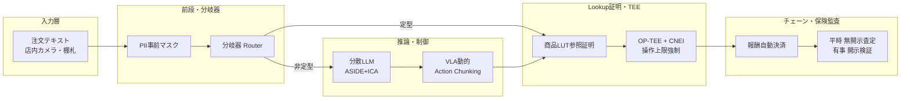

# ProofPick

「なぜその商品を選んだか」を証明できると、
AIロボットはもっと安心して暮らしに入ってくる

理想は「誰でもロボを安心して走らせられる社会」— まずその核心をデモに落とし込みました 
第4回 全国情報教育コンテスト（全情コン2026）／愛知県大会 応募作品

---
layout: section
---

# 理想（ビジョン）

誰でもAIロボを安心して走らせられる社会へ

---

# 理想 — インフラ分離

店舗・倉庫（場の提供者）

ロボットを所有しない。「走れる場」と「安全を検証する仕組み」だけを提供。

外部AIロボット（稼働者）

自分の技術（知財）は隠したまま稼働し、完了証明を出すたびに報酬を得る。

この理想のねらい

<ul class="text-sm space-y-2 opacity-85">
<li>「店がロボットを買い取る」構造を壊す</li>
<li>同じ仕組みをデータ転用で<b>スーパー・物流・薬局・介護</b>へ横展開できる</li>
<li>AI企業も、店も、客も、損保も、みんな安心できる</li>
</ul>

---

# なぜこの理想か — 現場の3つの壁

💰

CAPEX の壁

スーパーや中小物流倉庫が自前でロボットを買い取り、維持管理（修理・AI更新）し続けるのは不可能。

🛡️

責任の所在が検証できない

AIが商品を誤認したら事故になる。でも「AIのミスか、データの不備か」どこに責任があるのかを第三者が検証できない。

🔒

監査済みか分からない

AI企業はモデルの中身を見せたくない。でも外部からは「本当に監査済みなのか」を検証できない。

この3つの壁は、どれも「信頼をどう証明するか」に行き着く

---

# 核心は、1つの問い

最初の問い

「どうやって賢い買い物ロボットを 作るか？」

たどり着いた核心の問い

「ロボに“<b>なぜその商品を選んだか</b>”を証明させられれば、店も客も損保も安心できる。その仕組みをどう作るか？」

つまり「商品選択の根拠」を第三者に示せること。これが ProofPick の核心です。

---
layout: section
---

# 研究（CSS2026）

核心を実現する要素技術を、最新学会から特定

---

# 核心に必要な要素技術（CSS2026）

<b>分岐器トリアージ</b> — 定型注文をLLMなしで高速処理（4E3-5 北島・吉塚・宮本・高橋・櫻井）

<b>ASIDE＋ICA 動的ゲート</b> — 悪意ある指示をデータから分離して無力化（4E3-4 米田・大塚）

<b>VLA 動的 Action Chunking</b> — 視覚ノイズによる暴走を抑止（2D4-1 山辺・佐久間）

<b>CNEI モデル外強制</b> — 許可した操作の範囲を超えさせない（1E2-2 中井・東・大西）

<b>決定論的 Lint（証跡拘束）</b> — 根拠の記録を改ざん・劣化させない（1D2-4 古川・津田・渡邉ら）

<b>OP-TEE 自動署名</b> — 安全が確認できた時だけ自動で承認（4B2-1 濱口・瀧田・野村ら）

<b>DCSS 墨塗署名</b> — 機密は隠したまま検証可能に（5B1-4 廣瀬・駒野）

上記は CSS2026 学術論文集の報告手法です。自チームではこれらを調査・選定し、まず核心の1点を形にしました（次のセクション）。

---
layout: section
---

# 落とし込み（実際に形にしたもの）

理想を、まず「動くデモ」にまで下ろした

---

# 落とし込み — 核心を1つのデモに

理想は大きい

インフラ分離・知財秘匿・自動監査。全部やるのは時間がかかる。

だから核心1点に絞った

「<b>なぜその商品を選んだか</b>」の根拠を、画面で見せて記録するデモをブラウザで作った。

ここに暗号はまだ載せていない

まず「人が分かる形」で核心を提示。証明の強化はこの先（理想）。

動作するデモ（右は埋め込み）

<a href="/demo.html" target="_blank" class="text-emerald-300 text-sm hover:underline">→ 別タブで開く</a>

---

# デモの流れ（4ステップ）

STEP 1

<b>注文</b> 「小麦不使用のルー」を注文。氏名・住所は即マスク。

STEP 2

<b>候補の比較</b> 小麦あり198円 vs 米粉258円。アレルゲン→価格で比較。

STEP 3

<b>根拠付き選択</b> 「アレルゲン基準に適合」という理由で米粉を選択。

STEP 4

<b>安心バッジ</b> 「✓基準適合」「✓根拠記録済」を緑バッジで表示。

<iframe src="/demo.html" class="mt-5 w-full h-[300px] rounded-xl border border-slate-700 bg-slate-950" loading="lazy"></iframe>

---

# デモが示していること

<b>専門用語ゼロ</b> — お客さまが見るのは「✓ アレルギー基準適合」の緑バッジだけ。数式は出さない。

<b>根拠が残る</b> — 裏では「決定証跡」（どの候補を、何の基準で、なぜ選んだか）を記録し、あとから検証できる。

<b>個人情報を出さない</b> — 注文時点で氏名・住所はマスク。お客さまのプライバシーを守る。

<b>ここからが「理想」への道</b> — この根拠を暗号で第三者に証明できるようにするのが、次のステップ。

---
layout: section
---

# 落とし込みの先（理想の全体像）

核心が動いたら、この全体へ拡張する

---

# 理想の全体像（システム構成）

---

# 作るもの：3点セット

① 実行基盤

店舗・倉庫に常設するインフラ。分岐器・PIIマスク・操作上限強制でモデルの外から安全を担保。

② 標準モデル

ロボットに搭載するベースラインAI。悪意ある指示の無力化と、視覚ノイズによる暴走の抑止。

③ 根拠の証明（本デモ）

「なぜ選んだか」を記録・提示する画面。まずはここを形にした。

---

# 展望 — どこへ広がるか

<b>病院・薬局の調剤</b> — 処方ミスゼロを、データを隠したまま証明。

<b>介護施設の見守り・配膳</b> — プライバシー映像を漏らさず、安全な行動だけを家族・保険会社へ証明。

<b>物流・自動運転・ドローン</b> — 事故時に、警察や裁判所だけが検証できる基盤へ。

同じ「実行基盤＋根拠の証明」を、シーン別データに差し替えるだけで横展開できる。

---

# 各賞へのマッピング

<b>ソフトバンク AIチャレンジ賞</b> — AIに丸投げせず「判断理由」を証明する設計。質疑ではCSS2026の理解で応答。

<b>東進 AIデータサイエンス賞</b> — 情報Ⅱの探究4プロセス（課題設定→収集→分析→表現）を実践。

<b>スペースブロック クリエイティブイノベーション賞</b> — モノ（ロボット）× デジタル（証明）を、実際のデモまで落とし込んだ。

<b>SAMURAIチャレンジ賞／やりたいをカタチに賞</b> — 「店がロボットを買い取る」常識を壊す発想を、動く形にした挑戦。

---
layout: section
---

# 探究のプロセス

情報Ⅱの4プロセスに沿って

---

# 探究の4プロセス

<b>① 課題設定</b> 街の配膳・清掃ロボを見て「間違った商品を届けたら怖い」と疑問を持つ

<b>② 収集</b> CSS2026論文を調査し、核心に必要な要素技術を特定

<b>③ 分析</b> 「全部やるのは無理」と判明 → 「根拠の証明」が本質と気づく

<b>④ 表現</b> 核心を「商品選択の根拠」デモとして形にした

<b>次にやりたいこと</b>：実店舗での試用 → 損保会社との共同実証 → 暗号による証明の強化

---

# 倫理・プライバシーへの配慮

<b>プライバシー</b> — 氏名・住所は注文時点でマスク。生データは外部へ出さない。

<b>著作権・出典</b> — OSSはライセンス準拠、CSS2026の手法は出典を明記。

<b>データ安全</b> — 決定証跡は改ざんできない形で記録し、権限のある人だけが検証できる。

<b>AI倫理</b> — AIに判断を丸投げせず、根拠を残すことで説明責任を果たす。

---
layout: center
---

# まとめ

ProofPick は、<b>「なぜその商品を選んだか」を証明できる</b>という核心から始まります。

理想は「誰でもAIロボを安心して走らせられる社会」。まずその核心を<b>動くデモ</b>に落とし込みました。

ここから、暗号による証明の強化と、実行基盤全体への拡張へ進みます。

デモ: html/demo.html ／ リポジトリ: github.com/sururu-k/ProofPick

